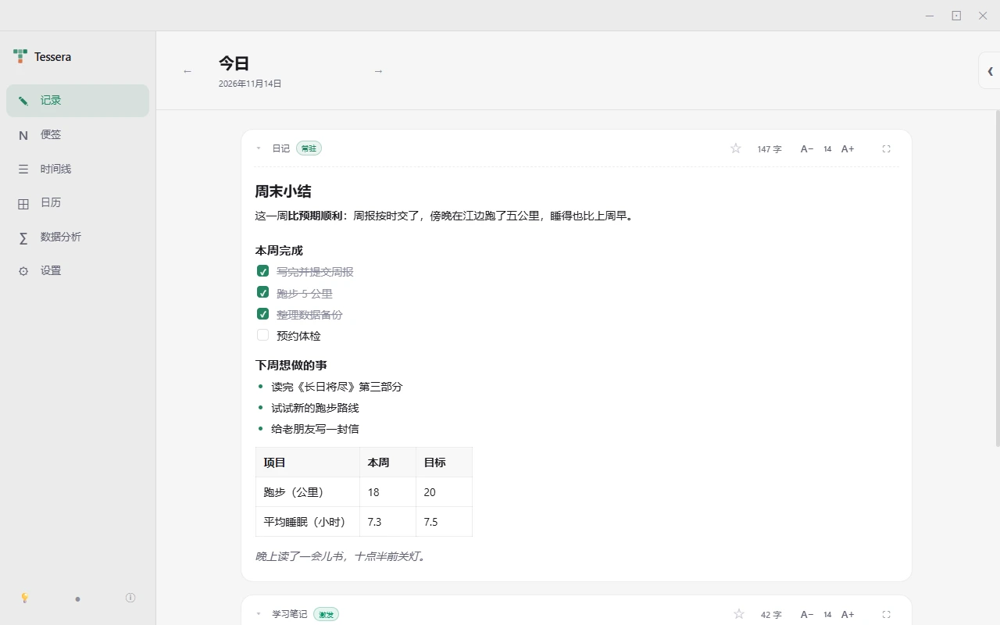
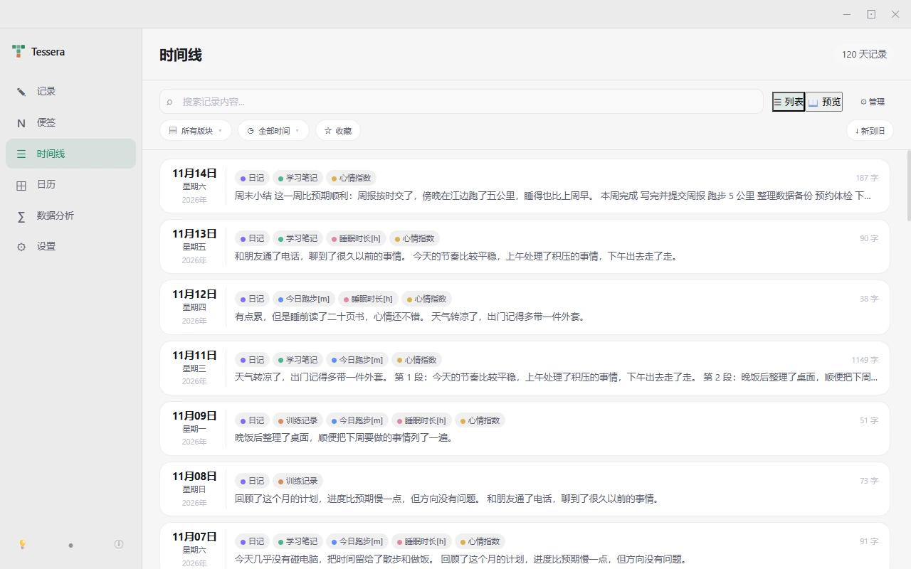
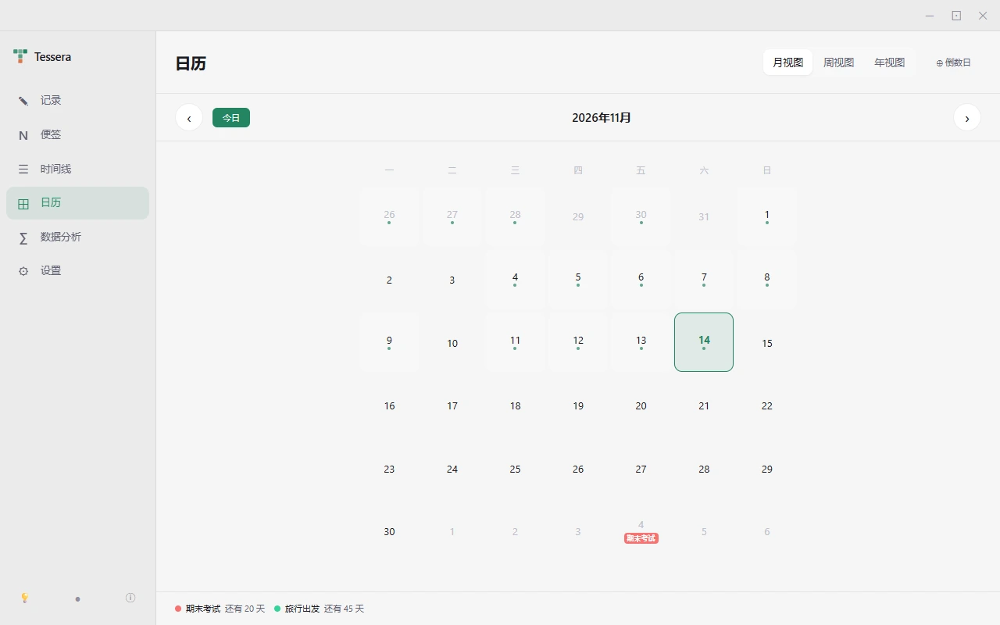
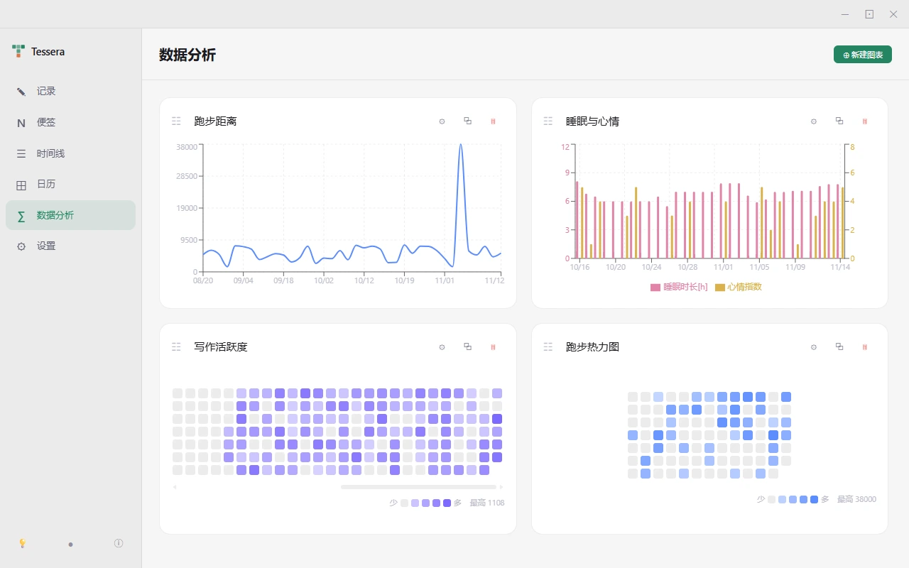
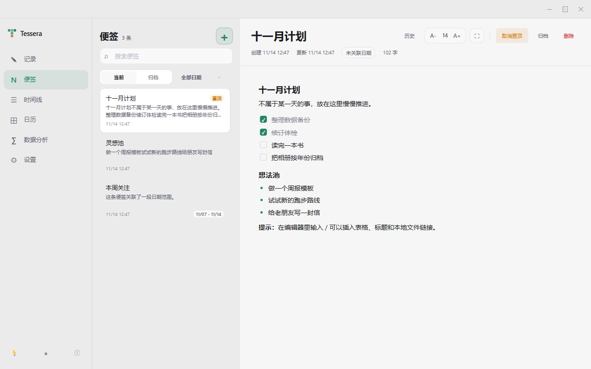
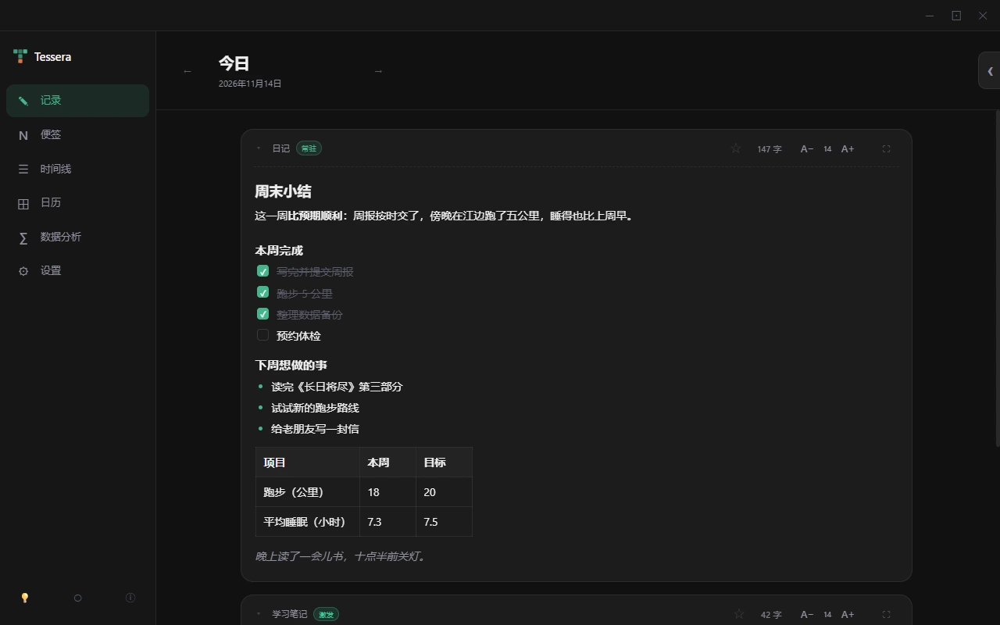
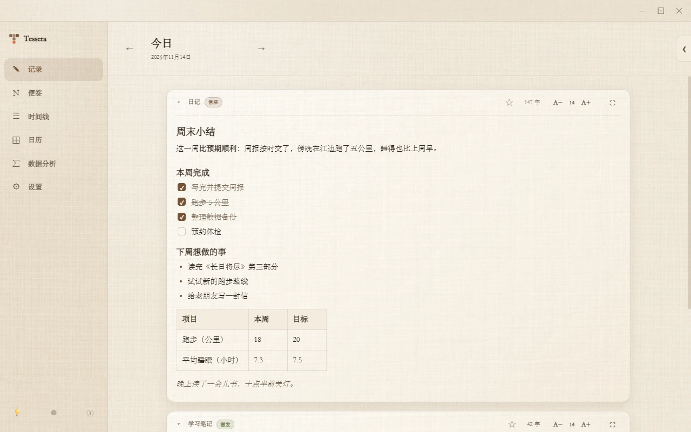
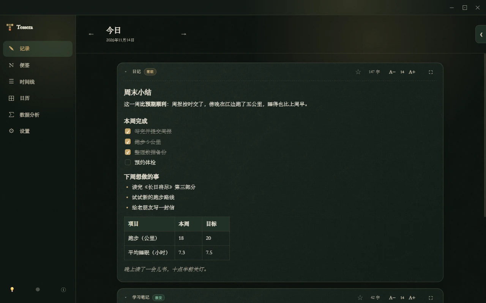
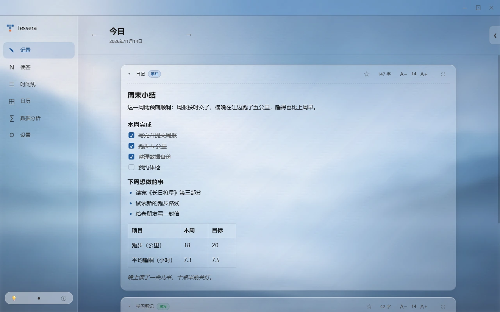

<div align="center">


# Tessera

**一款本地优先的 Windows 个人记录软件**<br>
写日记、记数字、回看历史、画趋势图——数据只存在你自己的电脑上。

[](https://github.com/qikaiLab/tessera/releases)
[](#-下载与安装)
[](LICENSE)
[](https://github.com/qikaiLab/tessera/releases)

[📦 下载安装](#-下载与安装) · [🚀 快速开始](#-快速开始) · [❓ 常见问题](#-常见问题) · [💬 反馈问题](https://github.com/qikaiLab/tessera/issues) · [📝 更新日志](CHANGELOG.md)



</div>

<!-- 演示视频：制作完成后，把链接加在这里（例如一行「▶ 观看 3 分钟介绍视频」）。 -->

> **1.0 是首个稳定版本**：核心功能完整，数据是你电脑上的普通 JSON 文件，之后的更新会保持对已有数据的兼容。数据保护有大量自动化测试覆盖（包括随机构造的异常数据、反复强制结束程序的崩溃测试），但软件仍由一个人在业余时间维护，请养成定期「导出 ZIP」备份到别处的习惯（见[数据与隐私](#-数据与隐私)）。

<details>
<summary><b>English summary</b></summary>

**Tessera** is a local-first self-tracking app for **Windows 10/11 (64-bit)**. You define "sections" (text or number), write one page per day, then browse your history on a timeline and calendar and chart trends. Everything is stored as plain JSON files on your own computer: no account, no cloud, and (since 0.5.0) the app makes no network connections of its own.

- The interface is **Simplified Chinese only** for now; there are no plans for other languages or platforms yet.
- Download the installer from [Releases](https://github.com/qikaiLab/tessera/releases/latest). It is **not code-signed**, so Windows SmartScreen will warn you on first run; each release ships a `SHA256SUMS.txt` to verify the download. There is no auto-update.
- Licensed under [PolyForm Noncommercial 1.0.0](LICENSE): free for personal and non-commercial use, source-available (not OSI open source).
- Bug reports and feature requests are welcome as [GitHub issues](https://github.com/qikaiLab/tessera/issues) (English is fine). Pull requests are **not** accepted. Security problems: see [SECURITY.md](SECURITY.md).

</details>

---

## ✨ Tessera 是什么

在信息碎片化的时代，Tessera 帮你把零散的记录整理成**结构化的自我认知**：日记心情、运动数据、学习进度、花销、睡眠……你自己决定要追踪什么，每天往里记一点，日子久了就能回看、搜索，也能一眼看出趋势。

- 🔒 **完全本地** — 没有账号，不上传，没有统计和广告；从 0.5.0 起程序自己不发起任何网络连接。数据是你电脑上的普通文件。
- 🧩 **自己定义要记什么** — 每天的页面由若干张「版块」卡片组成：「日记」是文字版块（富文本编辑器），「体重」是数字版块，数量和种类由你决定。常驻版块每天都在，非常驻的版块在需要时再添加。
- 📊 **从记录到洞察** — 折线图、柱状图、饼图和热力图，让积累的数据“说话”。
- 🛡️ **把数据安全放在第一位** — 写入不怕断电、崩溃恢复、自动历史版本、定期备份；多数误改、误删都可以找回（历史有容量和保留期限）。

**适合谁**：想长期坚持记录、看重隐私、喜欢按自己的方式整理信息的人。<br>
**可能不适合你**：需要手机端、多设备实时同步或多人协作——Tessera 目前只有 Windows 桌面版，也不提供账号和云同步。

## 🖼️ 界面一览

<table>
  <tr>
    <td width="50%"><br><sub><b>时间线</b>：按日期回看，全文搜索、筛选、收藏</sub></td>
    <td width="50%"><br><sub><b>日历</b>：月 / 周 / 年视图，倒数日一目了然</sub></td>
  </tr>
  <tr>
    <td width="50%"><br><sub><b>数据分析</b>：自定义图表，多项数据同图对比</sub></td>
    <td width="50%"><br><sub><b>便签</b>：不属于某一天的长期笔记，可关联日期</sub></td>
  </tr>
</table>

**四套界面风格**，可随时切换（从左到右：默认、亚麻书房、墨玉档案、雾化玻璃）：

<table>
  <tr>
    <td width="25%"><br><sub><b>默认</b>：深浅色 + 八种主题色</sub></td>
    <td width="25%"><br><sub><b>亚麻书房</b>：米色纸张，固定浅色</sub></td>
    <td width="25%"><br><sub><b>墨玉档案</b>：深色书房，固定深色</sub></td>
    <td width="25%"><br><sub><b>雾化玻璃</b>：可换壁纸，配色自适应</sub></td>
  </tr>
</table>

## 📦 下载与安装

**系统要求**：Windows 10 或 Windows 11（64 位）。不需要联网，也不需要任何账号。

1. 打开 **[Releases 页面](https://github.com/qikaiLab/tessera/releases/latest)**，在最新版本的 Assets 里**只下载** `Tessera-Setup-x.y.z.exe`（约 100 MB）。同一页里的 `.blockmap`、`latest.yml`、`SHA256SUMS.txt` 是校验用的辅助文件，不需要下载运行。
2. 运行安装程序，按提示安装。推荐选「仅为当前用户安装」，这样不需要管理员权限。
3. **第一次运行时 Windows 可能弹出蓝色的 SmartScreen 提示**（“Windows 已保护你的电脑”）。这是因为安装包**目前没有做代码签名**，不代表有问题：点「更多信息」→「仍要运行」即可。

**下载前请知道**：

- Edge / Chrome 可能因为安装包没有签名而先拦截下载，在下载列表里选「保留」即可。
- Windows 11 如果开启了「智能应用控制」，它会直接阻止未签名的程序，这时无法安装；关闭该功能是不可逆的，请自行权衡。
- 数据是明文的 JSON 文件，**没有加密，也没有应用锁**：能打开你电脑上这个文件夹的人都能读到。需要保密请配合磁盘加密（如 BitLocker）。
- 编辑器里暂时不能插入图片（可以链接到本机的图片文件）。

想确认下载的文件是完整的？每个 Release 都附有 `SHA256SUMS.txt`，在 PowerShell 里计算下载文件的哈希，与它对照（忽略大小写；两者在同一个 Release 里，所以它只能证明文件完整，不能证明发布者身份）：

```powershell
Get-FileHash .\Tessera-Setup-*.exe -Algorithm SHA256
```

**升级**：目前没有自动更新。新版本发布后，下载新的安装程序直接运行即可覆盖升级，数据目录不会被改动。升级前建议先导出一份 ZIP 备份。<br>
**卸载**：从 Windows「设置 → 应用」卸载。卸载程序里的「删除所有用户数据」只会清空默认数据目录，**你自己选的数据目录永远不会被清空**。<br>
**杀毒软件**：未签名的新程序偶尔会被个别杀毒软件警告；如遇到，可对照上面的哈希确认文件完整后再放行。

## 🚀 快速开始

1. 安装后已经有「日记」版块，直接在 **记录** 页里写就行，**自动保存**，不用点保存。
2. 想追踪体重、时长这类数字，到 **设置 → 数据版块** 添加「数字」版块（也可以再添加更多「文字」版块）。
3. 过几天后，用 **时间线** 搜索和回看，用 **日历** 按日期跳转。
4. 数字版块积累了数据后，到 **数据分析** 新建图表观察趋势。

软件内置了完整的使用说明：按 `F1`（或点侧栏左下角的 💡）打开，支持关键词搜索；`Ctrl + /` 打开快捷键清单。

## 🧰 主要功能

| 模块 | 能做什么 |
| --- | --- |
| **记录** | 每天一页，由若干版块卡片组成。富文本编辑：标题、列表、待办、引用、代码块、**表格**；输入 `/` 唤出斜杠菜单；粘贴 Markdown 自动渲染（`Ctrl+Shift+V` 保留原文） |
| **本地文件链接** | 笔记可链接到本机的照片、文本或文件夹：点击即打开；程序等其他文件只在资源管理器中显示，**不会被运行** |
| **便签** | 不属于某一天的长期笔记：置顶、归档、搜索，可关联到某天或一段时间，在记录页的抽屉里随时翻看 |
| **时间线** | 按日期展示摘要；全文搜索、按版块和时间范围筛选、收藏；预览模式连续阅读 |
| **日历** | 月 / 周 / 年视图；有记录的日子带标记；倒数日（可每周 / 每月 / 每年重复，改动自动保存） |
| **数据分析** | 折线 / 柱状 / 饼图 / 热力图；数字版块按数值，文字版块按字数；多项数据同图对比 |
| **沉浸写作** | `Ctrl+Shift+Enter` 全屏写作，可调行宽、行距和字号 |
| **界面个性化** | 四套风格、深浅色、八种主题色、自定义壁纸与模糊度、字体字重、80%–150% 界面缩放 |
| **版块管理** | 拖拽排序，常驻 / 按需出现，重命名并自动关联历史数据 |

## 🔐 数据与隐私

- **完全本地**：从 0.5.0 起，Tessera 自己不发起任何网络连接（程序内部也禁止联网），没有账号、统计或广告。只有你点击笔记里的网址或「关于」里的作者链接时，才会交给系统默认浏览器打开；邮件、电话链接会唤起对应的程序。
- **数据在哪里**：默认在 `%USERPROFILE%\Tessera\data`，全部是普通的 JSON（文本格式）文件，可以用任何文本编辑器打开，不被软件“锁死”；程序设置在 `%APPDATA%\Tessera`。你可以在 **设置 → 数据与备份** 把数据目录换到外置硬盘或云同步盘。
- **多层保护**，防止崩溃、断电或手滑造成丢失：

  | 保护 | 说明 |
  | --- | --- |
  | 断电也不损坏 | 先写临时文件再整体替换，写到一半断电也不会留下损坏的数据 |
  | 崩溃恢复 | 启动时发现没写完的临时文件，会校验后引导你恢复，残缺的不会覆盖完好的文件 |
  | 自动历史 | 每次保存或删除前自动留存压缩的历史版本，误改、误删的记录和便签可以找回（[说明](docs/DATA_RECOVERY.md)） |
  | 手动备份 | 一键备份为 ZIP（存在数据目录里的 `backups` 文件夹），保留最近 30 份；也可以导出 / 导入 ZIP |
  | 导入校验 | 导入前先校验每个文件；有一个损坏就一个都不写入，现有数据不会被动 |
  | 删除保护 | 已有记录的版块无法误删；批量删除需要二次确认 |

- ⚠️ **请定期备份**：自动历史和一键备份都保存在数据目录内，那块磁盘坏了就会一起丢。重要的数据请定期用「导出 ZIP」（不含自动历史）备份到另一块磁盘或网盘。
- **云同步盘**：数据目录可以放进云同步盘，但同步由该服务负责，不要在两台电脑上同时打开同一份数据。
- 软件按「现状」提供，不附带任何担保（见[许可证](LICENSE)）。

## ❓ 常见问题

**数据存在哪里？可以备份或搬到新电脑吗？**<br>
默认在 `%USERPROFILE%\Tessera\data`。在「设置」页一键导出 ZIP，到新电脑上安装后用「导入 ZIP」导入即可（导入会覆盖新电脑上已有的记录，最好在全新安装时做）。也可以把整个数据文件夹复制过去，在「设置」里选择它。更改数据目录时，软件会在下次启动时整夹复制并逐个核对，通过后才切换，旧目录原样保留。

**为什么删除版块时提示无法删除？**<br>
该版块已有历史数据，系统会阻止误删。不想再看到它，把它设为「非常驻」即可，历史数据会保留。

**安装时出现“Windows 已保护你的电脑”？**<br>
安装包目前没有代码签名（个人项目，签名证书需要付费），所以 Windows 会提示未知发布者，详见上面的「下载与安装」。

**支持 macOS、Linux 或手机吗？有英文界面吗？**<br>
目前仅支持 Windows 10/11（64 位），界面仅有简体中文，暂时没有扩展平台或语言的计划。

**怎么在多台电脑之间同步？**<br>
没有内置同步。可以把数据目录设在云同步盘里，但同一时间只在一台电脑上打开；或者定期导出 / 导入 ZIP。

**屏幕比较小，或者系统缩放比例很高，界面显示不全？**<br>
窗口会自动适应屏幕的可用区域，小屏幕和高缩放比例（如 1366×768 的 125%）也能完整显示。字太小或太大可以在「设置」里调整界面缩放（80%–150%），或用 `Ctrl + 鼠标滚轮`。如果仍有问题，请[提一个 Issue](https://github.com/qikaiLab/tessera/issues)，并写上屏幕分辨率和缩放比例。

**软件免费吗？可以商用吗？**<br>
个人使用、学习研究、爱好项目，以及教育、公益等非营利机构均可免费使用。商业用途需要另行取得作者许可，详见[许可证](#-许可证)。

**发现 Bug 或有建议，怎么反馈？**<br>
到 [Issues](https://github.com/qikaiLab/tessera/issues) 选对应的模板提交（中英文均可）；软件内「关于」对话框可以一键复制版本信息，方便描述问题。请不要在 Issue 里贴真实的个人记录。涉及安全的问题请见 [SECURITY.md](SECURITY.md)。

## 🤝 反馈与参与

- **欢迎**：[Issue](https://github.com/qikaiLab/tessera/issues)——缺陷报告、使用问题、功能建议。项目由一位维护者在业余时间维护，回复可能不及时，请见谅。
- **暂不接受**：Pull Request。这是一个由单人维护、主要通过 AI 助手协作开发的项目，想要的改动请先在 Issue 里说明场景，由维护者评估和实现。原因和细节见 [CONTRIBUTING.md](CONTRIBUTING.md)。
- **安全问题**：请不要公开发布，按 [SECURITY.md](SECURITY.md) 用邮件私下联系。

## 📝 最近更新

完整的版本历史见 **[CHANGELOG.md](CHANGELOG.md)**，每个版本的安装包见 [Releases](https://github.com/qikaiLab/tessera/releases)。

### v1.1.0 *(2026-11-22)*

- **倒数日重做**：改成日历右侧的抽屉，新建一步保存、已有的点开就能改并自动保存；支持每周、每月、每年或隔几周 / 几个月 / 几年重复（生日选「每年」即可）；日历下方新增「最近」条，一天有多个倒数日时月、周、年视图都能看到，各部分都有动画。
- 雾化玻璃新增三张**内置壁纸**（暮光、森林、海洋），在设置里点选即换，玻璃层和点缀色自动适配。
- 修复雾化玻璃亮色主题下对话框难以辨认、右键菜单被格式工具栏盖住等可读性问题。已有数据原样保留，无需迁移。

### v1.0.0 *(2026-11-14)*

- **首个稳定版本**。小屏幕和高缩放比例（如 1366×768 的 125%）下窗口自动适应可用区域，不再有部分超出屏幕的情况。
- 导入 ZIP 前先检查大小，过大或异常的压缩包会被拒绝并且不改动任何数据；损坏、极端或恶意构造的数据文件（嵌套极深的文档、不是真实日期的文件名、过大的图表范围等）不再让页面出错。
- 新增更全面的自动化测试：随机构造的异常数据、恶意粘贴、三年历史压力和编辑时反复强制结束程序的崩溃测试。

### v0.5.0 *(2026-11-12)*

- 应用更名为 **Tessera**，换用新图标；新安装默认松绿色浅色界面。
- 编辑器新增**表格**、`[文字](网址)` 自动成链接和 **Markdown 粘贴**；笔记可链接到本机的文件和文件夹（不会运行程序）。软件内的使用说明改为可搜索的手册（`F1`）。
- **数据更安全**：崩溃恢复不再用残缺文件替换完好文件，导入 ZIP 先校验后写入，更改数据目录改为“复制并逐个核对，通过才切换”；程序不再联网。

技术细节（沙盒、内容安全策略、安装程序保护等）见 [CHANGELOG.md](CHANGELOG.md)。

## 🛠️ 开发者指南

<details>
<summary>技术架构、构建与发布流程（普通用户可以跳过）</summary>

### 技术架构

```
Electron (electron-vite)
├── Main Process     → 文件系统 I/O、IPC 桥接、原子写入、ZIP 备份管理
├── Preload Script   → 安全地将受限的原生能力暴露给渲染层
└── Renderer (React 18)
    ├── AppContext    → selectedDate / sections 全局单点状态管理
    ├── Pages         → Today / Notes / Timeline / Calendar / Analytics / Settings
    └── Components    → TiptapEditor / Charts / DragSortable / Modal 等
```

| 库 | 版本 | 用途 |
|----|------|------|
| [Electron](https://www.electronjs.org/) | 43.x | 桌面外壳 |
| [React](https://reactjs.org/) | 18.x | UI 框架 |
| [Tiptap](https://tiptap.dev/) | 3.x | 富文本编辑器引擎 |
| [Recharts](https://recharts.org/) | 2.x | 图表渲染 |
| [dnd-kit](https://dndkit.com/) | 6.x / 8.x | 拖拽排序 |
| [date-fns](https://date-fns.org/) | 3.x | 日期计算与格式化 |
| [JSZip](https://stuk.github.io/jszip/) | 3.x | 数据备份压缩 |

### 项目结构

```
Tessera/
├── .github/workflows/    # GitHub Actions — 日常质量门禁、Tag 自动发布
├── docs/                 # 工程化管理指南、数据恢复说明、README 截图
├── scripts/              # 版本校验、清理产物、开发示例数据、截图生成等脚本
├── src/
│   ├── main/             # 主进程：窗口与生命周期、数据文件、备份；ipc/ 按主题注册 IPC handler
│   ├── preload/          # 预加载脚本：安全桥接 window.api
│   └── renderer/src/     # 渲染层：context / pages / components / utils / theme / styles
├── tests/                # Vitest 单元与契约测试；tests/e2e 是 Playwright 的 Electron 端到端测试
├── electron.vite.config.js
└── package.json
```

### 环境准备与启动

需要 [Node.js](https://nodejs.org/) >= 22.12、npm >= 10、Windows 10/11。

```bash
git clone https://github.com/qikaiLab/tessera.git
cd tessera
npm ci

npm run dev          # 开发模式（热重载）；使用独立的开发数据目录，不会碰真实数据
npm run seed:dev     # 往开发数据目录填充示例数据
npm run dist         # 生产打包，在 release/ 下生成 NSIS 安装包
npm run screenshots  # 用示例数据重新生成 README 里的截图（docs/screenshots/）
```

### 质量检查

[](https://github.com/qikaiLab/tessera/actions/workflows/ci.yml)

合并前执行 CI 使用的质量门禁（CI 在此基础上还会运行端到端测试）：

```bash
npm run check
```

依次运行 ESLint、Vitest、版本一致性检查和生产构建；依赖漏洞审计 `npm run audit` 单独运行（CI 每周及依赖文件变更时也会运行，发布前随 `npm run check:release` 一起执行）。涉及界面或主进程的改动还应运行相关的端到端测试，如 `npx playwright test tests/e2e/app-shell.spec.mjs`（需要先有最新构建；Electron 端到端测试默认在屏幕外静默运行，使用临时数据目录），只有改动主进程、预加载或打包时才需要全量的 `npm run test:e2e`。随机化的模糊测试在 `tests/fuzz/`，随 `npm test` 一起运行；失败时会打印随机种子，用 `FUZZ_SEED=<数字>` 可以重放，`FUZZ_RUNS=<数字>` 可以加大次数。分支、提交、依赖维护与发布规则见 [CONTRIBUTING.md](CONTRIBUTING.md) 和 [工程化管理指南](docs/ENGINEERING_GUIDE.md)。

### 发布新版本（CI/CD 自动化）

在 `main` 上同步版本与文档后，推送符合 `v*` 的附注标签，GitHub Actions 会在 Windows 云端构建、运行全部测试和打包产物冒烟测试，并把安装包附加到 Release：

```bash
npm version patch --no-git-tag-version
# 更新 README.md（版本徽章与「最近更新」）、CHANGELOG.md 与 RELEASE_NOTES.md 后执行完整门禁
npm run check:release
git add package.json package-lock.json README.md CHANGELOG.md RELEASE_NOTES.md
git commit -m "chore(release): vX.Y.Z"
git push origin main

# main 上不会自动跑 CI：手动触发一次，等它成功后再创建附注标签，并只推送这一个标签
gh workflow run ci.yml --ref main
git tag -a vX.Y.Z -m "Tessera vX.Y.Z"
git push origin vX.Y.Z
```

已推送的版本标签不得删除、移动或复用；发布失败时修复后增加补丁版本。每个 Release 同时提供 `latest.yml`、安装包增量元数据和 `SHA256SUMS.txt`，用于完整性校验。

</details>

## 🙏 开发与致谢

Tessera 由作者 **7k**（[qikaiLab](https://github.com/qikaiLab)）与两位 AI 编程助手共同开发：

- **[Claude](https://www.anthropic.com/claude)**（Anthropic）
- **[Codex](https://openai.com/codex)**（OpenAI）

作者负责需求、设计取舍与最终决定，并通过自然语言与助手协作完成方案讨论、编码、测试与文档。软件使用的第三方组件及其许可证见应用内「关于 → 许可与致谢」。

## 📄 许可证

Tessera 以 [PolyForm Noncommercial License 1.0.0](LICENSE) 发布：**源码公开，个人学习、研究、爱好项目，以及教育、公益等非营利机构均可免费使用、修改与分发；商业用途需另行取得作者许可。** 这不是 OSI 定义的「开源」许可证，而是源码可见（source-available）许可证。

© 2026 qikaiLab. Built with ❤️ using Electron + React.
